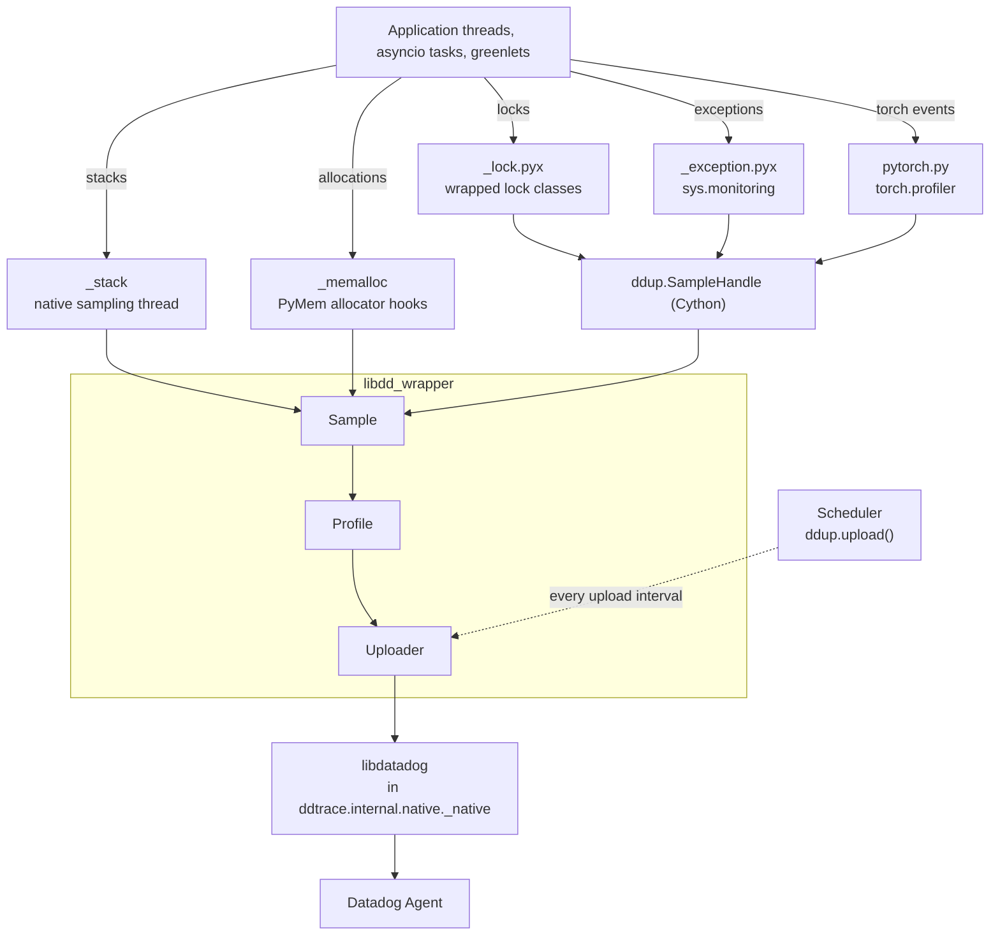

# Python Profiler Architecture

The profiler has a Python layer and a native layer.
The Python layer starts and stops the profiler, installs the hooks that collectors need, and triggers uploads.
The native layer samples stacks and memory allocations, stores every sample in one profile, and passes the profile to libdatadog, which encodes and uploads it.

Full paths are relative to the repository root.
Short native paths such as `dd_wrapper/...`, `stack/...` and `cmake/...` are relative to `ddtrace/internal/datadog/profiling/`.

## Components

| Component | Path | Role |
|-----------|------|------|
| Product plugin | `ddtrace/internal/profiling/product.py` | Entry point (`profiler` in `pyproject.toml`). Installs the thread, asyncio and gevent hooks at startup when needed, and starts the profiler when it is enabled. |
| Lifecycle | `ddtrace/internal/profiling/lifecycle.py` | Holds the profiler that bootstrap or Remote Config started, and the lock that both take before they replace it. |
| Remote Config | `ddtrace/internal/profiling/remoteconfig.py` | Merges the profiling configurations that target this process (a more specific target wins) and restarts the profiler with the resulting collectors and settings. |
| Profiler | `ddtrace/profiling/profiler.py` | `Profiler` allows one running instance per process. `_ProfilerInstance` creates the collectors and the scheduler. |
| Scheduler | `ddtrace/profiling/scheduler.py` | Every `DD_PROFILING_UPLOAD_INTERVAL` (60 s), calls `snapshot()` on each collector, then `ddup.upload()`. On AWS Lambda, `ServerlessScheduler` wakes every second and uploads after 60 wakeups. |
| Collectors | `ddtrace/profiling/collector/` | See [Collectors](#collectors). |
| Thread, task and greenlet tracking | `ddtrace/profiling/collector/threading.py`, `ddtrace/profiling/_asyncio.py`, `ddtrace/profiling/_gevent.py`, `ddtrace/profiling/_threading.pyx` | Tell the stack sampler about threads, event loops, links between asyncio tasks, and greenlet switches. |
| dd_wrapper | `dd_wrapper/` | C++ shared library on top of the libdatadog profiling FFI. Holds the process-global profile. |
| ddup | `ddup/` | Cython bindings to dd_wrapper: `config`, `start`, `upload`, `reset` and `SampleHandle`. |
| stack | `stack/` | Native stack sampler, built on a vendored copy of echion (`stack/echion/`, `stack/src/echion/`). |
| Code provenance | `code_provenance.py`, `dd_wrapper/src/code_provenance.cpp` | Writes a JSON file that maps source paths to the libraries they belong to. Every upload includes it. |
| Native heap | `heap_gotter/`, `src/native_heap_gotter/` | Patches the global offset table (GOT) so that allocator calls fire `ddheap` USDT probes, which an external eBPF profiler reads. Python does not collect or upload these samples. |

## Lifecycle

At startup, the product manager calls `post_preload()` in `product.py`.
If Remote Config may start the profiler later (the default, unless `DD_PROFILING_ENABLED=false` is set explicitly) or `DD_PROFILING_ENABLED=armed`, it installs the thread, asyncio and gevent hooks right away.
A profiler that starts later then still sees the threads, event loops and greenlets that already exist.
If `DD_PROFILING_ENABLED` is true, it imports `ddtrace.profiling.auto`, which calls `start_profiler()` in `ddtrace/profiling/bootstrap/sitecustomize.py`.

With `ddtrace-run`, the Remote Config poller can start before `ddtrace.profiling.auto` is imported, so bootstrap and Remote Config can change the profiler at the same time.
To prevent a conflict, both hold `lifecycle.lock` while they stop the current profiler and start a new one.

`_ProfilerInstance._start_service()` starts these parts in this order: native heap, `ddup.config()` and `ddup.start()`, collectors, scheduler.
The threading lock, asyncio lock and PyTorch collectors start only when the application first imports `threading`, `asyncio` or `torch` (`ModuleWatchdog`), so the profiler does not import these modules before the application does.
On stop, the scheduler stops first and uploads a last profile.
The collectors stop after that, because the last upload calls their `snapshot()`.
`Profiler.start()` also installs SIGTERM and SIGINT handlers that upload the last profile before the process exits.

## Collectors

Collector files are in `ddtrace/profiling/collector/`.

| Collector | How it works | Notes |
|-----------|--------------|-------|
| Stack (`stack.py`) | A native thread reads the stacks of threads, asyncio tasks and greenlets. It starts at a 10 ms interval and adjusts the interval to keep its CPU use near a target overhead. | Never takes the GIL. Tags samples with the active span, which it learns from tracer `core` events. On Python 3.12+, it also shows C functions called from Python (`ddtrace/internal/datadog/profiling/native_call_monitor.py`). |
| Memory (`memalloc.py`, `_memalloc*.cpp`) | Replaces the `PYMEM_DOMAIN_OBJ` allocator and, by default on Python 3.12+, the `PYMEM_DOMAIN_MEM` allocator. Takes about one sample per `DD_PROFILING_HEAP_SAMPLE_SIZE` bytes allocated, at random intervals. | Pushes each allocation sample immediately. Keeps sampled objects until they are freed, and pushes the live ones as heap samples in `snapshot()`. |
| Lock (`threading.py`, `asyncio.py`, `_lock.pyx`) | Replaces `Lock`, `RLock`, `Semaphore`, `BoundedSemaphore` and `Condition` in `threading`, and `Lock`, `Semaphore`, `BoundedSemaphore` and `Condition` in `asyncio`, with wrappers that create profiled locks. | Records the wait time to acquire and the hold time for `DD_PROFILING_CAPTURE_PCT` percent of lock operations. Installs the wrappers again after `gevent.monkey.patch_all()`. |
| Exception (`_exception.pyx`) | Registers a `sys.monitoring` RAISE callback through `ddtrace.internal.monitoring`. Samples about one in `DD_PROFILING_EXCEPTION_SAMPLING_INTERVAL` raised exceptions, at random intervals. | Python 3.12+ only. Off on free-threaded builds. |
| PyTorch (`pytorch.py`) | Wraps `torch.profiler.profile`. When a trace is ready, converts its events into samples. | Adds GPU time, GPU memory and FLOPs sample types. |

The lock, exception and PyTorch collectors push samples through `ddup.SampleHandle`.
The stack sampler and memalloc call dd_wrapper directly.

## From sample to upload

Each sample is built in a `Datadog::Sample` (`dd_wrapper/include/sample.hpp`):

1. `SampleManager::start_sample()` takes a `Sample` from a fixed-size pool, or allocates one if the pool is empty.
2. The caller pushes values, frames and labels.
3. `flush_sample()` adds the sample to the profile while it holds the profile lock.
4. `SampleManager::drop_sample()` returns the `Sample` to the pool.

memalloc does not use the pool: each sampled allocation keeps its own `Sample`.

All samples go into one `ddog_prof_Profile`, held by `ProfilerState` (`dd_wrapper/src/profiler_state.cpp`).
At upload, `UploaderBuilder::build()` holds the profile lock only while it swaps out the profiler stats and serializes the profile.
Serializing also empties the profile for the next interval.
`Uploader` then sends the encoded profile to the Agent with a blocking libdatadog call on the scheduler thread.
If `DD_PROFILING_OUTPUT_PPROF` is set, it writes the profile to a file instead.
During the send, it holds the upload lock but not the profile lock, so sampling continues.
Each upload creates a new exporter.

## Fork, gevent, uWSGI and Gunicorn

General fork-safety rules are in [`docs/contributing-architecture.rst`](../../../../../docs/contributing-architecture.rst) and the "Fork Safety" section of [`ddtrace/internal/README.md`](../../../../../ddtrace/internal/README.md#fork-safety).

Native code resets its state with `pthread_atfork` handlers.
These run on every `fork()`, including forks that skip Python's fork hooks, such as uWSGI workers.

- dd_wrapper (`ProfilerState::prefork` and related handlers): before the fork, it cancels an upload in progress, then takes the upload lock and the profile lock. In the child, it creates new locks, replaces the ProfilesDictionary with a new one, and resets the profile.
- stack: in the child, the handler from `Sampler::register_fork_cleanup` clears echion state and the list of threads, then registers the current thread. The handler from `Sampler::one_time_setup` then restarts the sampling thread if it was running in the parent. That handler is registered after the dd_wrapper handler, and POSIX runs child handlers in registration order, so the new ProfilesDictionary exists before sampling restarts.
- memalloc: in the child, it resets the heap tracker.

In Python, `Scheduler` is a `PeriodicService`, which restarts after a fork, and `lifecycle.lock` is a `forksafe.Lock`.

gevent: `_gevent.py` replaces `gevent.spawn`, `joinall`, `wait` and `iwait`, and installs a greenlet trace function in each thread.
The trace function reports each greenlet switch to the sampler (`stack.record_greenlet_switch`), so the sampler can unwind every greenlet separately.
In a fork child, `_gevent.py` clears its greenlet maps.
The thread hooks use `ddtrace.internal._unpatched._threading`, so gevent monkey-patching does not hide native threads from the sampler.

uWSGI: without `lazy-apps` or `py-call-uwsgi-fork-hooks`, the uWSGI master forks its workers from C, and Python fork hooks do not run.
`uwsgi.check_uwsgi()` detects this case.
The profiler then does not start in the master. `_start_on_fork` starts it in each worker through `uwsgidecorators.postfork`.
In these workers, exception profiling stays off: enabling `sys.monitoring` events walks every thread state, and the worker still lists the master's threads, which do not exist in the worker.

Gunicorn forks its workers with `os.fork()`, so the normal fork handling applies.

## Design decisions

**The stack sampler runs without the GIL.**
A sampler that holds the GIL sees other threads only at the points where they release it, which biases the profile.
A native thread that never takes the GIL samples threads wherever they are.
The trade-off is that this thread cannot call Python.
If an error stops it, it stores the error, and `StackCollector.snapshot()` logs it from the scheduler thread.

**The sampler reads interpreter memory with checked copies.**
Other threads change this memory while the sampler reads it, so a read can hit an unmapped page.
`copy_memory` (`stack/echion/echion/vm.h`) uses `process_vm_readv` on Linux and `mach_vm_read_overwrite` on macOS.
It can also use a faster `memcpy` ("fast copy"), with a SIGSEGV/SIGBUS handler that recovers from a bad read.
If another library replaces those signal handlers, it goes back to the system call.
`ddtrace/profiling/_faulthandler.py` wraps `faulthandler.enable()` and `faulthandler.disable()`, and pauses the sampler while it puts our handler back.

**One libdd_wrapper.**
`_ddup`, `_stack` and `_memalloc` all link the same prebuilt `libdd_wrapper`, which `setup.py` builds first.
So the process has one profile and one set of fork handlers, and the wheel stays small.
dd_wrapper uses the libdatadog code in `_native` (`src/native`, `profiling` feature), which the tracer also uses, so the wheel contains libdatadog only once.

**manylinux2014.**
The native code uses C++20 (`cmake/AnalysisFunc.cmake`), but Linux wheels must pass `auditwheel repair` for manylinux2014.
The build containers have a newer compiler than that specification allows, so do not use library features that need a newer libstdc++, such as `std::filesystem`.
They compile, but the wheel build then fails.

**Symbol visibility.**
Other extensions in the same process can load their own copies of libraries that we also use.
`add_ddup_config` (`cmake/AnalysisFunc.cmake`) links with `-Wl,--exclude-libs,ALL`, so we do not export the symbols of static libraries that we link, and with `-Wl,-Bsymbolic-functions`, so calls to our own functions do not resolve to another module's copy.
`_memalloc` also compiles with `-fvisibility=hidden`.

**String lifetimes.**
A string from Python, Cython or the sampler can be freed before the sample that uses it is flushed.
So function names and file names are interned in libdatadog's ProfilesDictionary, which lives longer than each profile.
Label values (thread name, task name, lock name) are copied into the sample's `StringArena`.

**Process-global native state is never freed.**
`ProfilerState::get()` and `Sampler::get()` create their instance once and never delete it.
uWSGI can call `exit()` without running the Python hook that stops the sampler, and `sys.monitoring` callbacks can still run during interpreter shutdown, so freeing this state could cause use-after-free crashes.

**Allocator hooks do not run Python code.**
memalloc's hooks run inside CPython's allocator, where Python code could release the GIL or allocate again.
So the hooks read frames through direct struct field reads and thread IDs through C APIs.
A thread-local guard skips nested calls, and on Python 3.10 and 3.11 the GC is disabled while a traceback is collected.

## CPython internals

The stack sampler and memalloc read CPython internal structures (`Py_BUILD_CORE`), so each new CPython version needs a check.
Use the `find-cpython-usage` and `compare-cpython-versions` skills in `.agents/skills/`.

## Building and testing

See [Testing.md](Testing.md) for all build, local, and CI checks, and [Standalone.md](Standalone.md) for `build_standalone.sh`.
